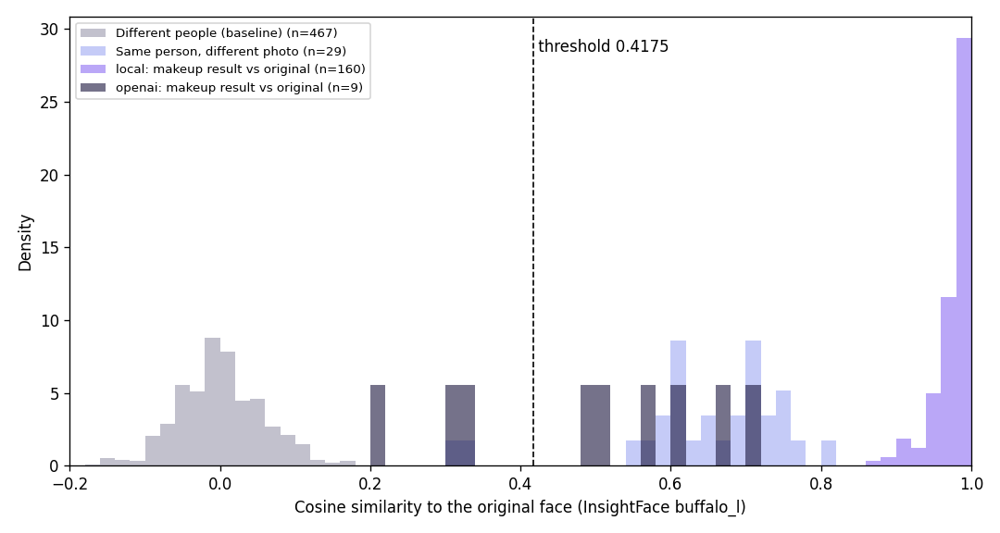

# Identity preservation results

Test faces: a subset of Labeled Faces in the Wild (LFW), news photos of public figures at low
resolution (250 x 250 pixels), 12 people. They vary in angle,
lighting and skin tone, but not in a controlled way. They are not customer selfies.

Pass threshold: **0.4175** cosine similarity (InsightFace buffalo_l), chosen by
`eval/calibrate.py` as the 5th percentile of same person pair similarities.

## Baseline: unedited photos

| Pairs | Count | Mean | Median | Min | Max |
| --- | --- | --- | --- | --- | --- |
| Different people | 467 | 0.001 | -0.001 | -0.164 | 0.176 |
| Same person, two different photos | 29 | 0.649 | 0.662 | 0.300 | 0.801 |

## Local baseline engine (paints on the photo, not generative)

This engine is a baseline, not generative AI: it paints the style onto the photo along face
landmarks and cannot change face shape. It shows how high identity scores are for an edit that
keeps the face by construction, for comparison with the generative engine.

| Style | Runs | Mean | Median | Min | Max | Pass rate, one attempt | Pass rate, with retries | Engine calls |
| --- | --- | --- | --- | --- | --- | --- | --- | --- |
| Natural | 32 | 0.992 | 0.993 | 0.980 | 0.999 | 100% (32/32) | 100% (32/32) | 32 |
| Soft glam | 32 | 0.969 | 0.972 | 0.886 | 0.996 | 100% (32/32) | 100% (32/32) | 32 |
| Bold lip | 32 | 0.980 | 0.982 | 0.942 | 0.993 | 100% (32/32) | 100% (32/32) | 32 |
| Smoky eye | 32 | 0.966 | 0.976 | 0.871 | 0.994 | 100% (32/32) | 100% (32/32) | 32 |
| Bridal | 32 | 0.965 | 0.967 | 0.886 | 0.995 | 100% (32/32) | 100% (32/32) | 32 |
| **All** | 160 | 0.975 | 0.982 | 0.871 | 0.999 | **100% (160/160)** | **100% (160/160)** | 160 |

Scores and the pass rate with retries use the final result per photo and style: the best of the
retry run where one was made, otherwise the single attempt. Retry runs made: 0.

### Worst 5 results (local)

1. `person_12/person_12_0002.jpg`, smoky_eye, single: **0.871**, passed; lowest scores of the set.

   Before and after images are available on request.

2. `person_04/person_04_0002.jpg`, bridal, single: **0.886**, passed; lowest scores of the set.

   Before and after images are available on request.

3. `person_04/person_04_0002.jpg`, soft_glam, single: **0.886**, passed; lowest scores of the set.

   Before and after images are available on request.

4. `person_12/person_12_0001.jpg`, smoky_eye, single: **0.907**, passed; lowest scores of the set.

   Before and after images are available on request.

5. `person_11/person_11_0002.jpg`, soft_glam, single: **0.914**, passed; lowest scores of the set.

   Before and after images are available on request.

## OpenAI gpt-image-1.5 (generative, small sample)

**This is a small sample** (10 photos, styles: soft_glam). The numbers show how this sample behaved and are
not a reliable estimate of the pass rate on real customers.

| Style | Runs | Mean | Median | Min | Max | Pass rate, one attempt | Pass rate, with retries | Engine calls |
| --- | --- | --- | --- | --- | --- | --- | --- | --- |
| Soft glam | 10 | 0.489 | 0.511 | 0.215 | 0.709 | 50% (5/10) | 60% (6/10) | 14 |
| **All** | 10 | 0.489 | 0.511 | 0.215 | 0.709 | **50% (5/10)** | **60% (6/10)** | 14 |

Scores and the pass rate with retries use the final result per photo and style: the best of the
retry run where one was made, otherwise the single attempt. Retry runs made: 3.

### API calls and cost (openai)

* API calls made: 14 (failed: 1)
* Tokens reported by the API: 2574 text input, 56602 image input, 4086 text output, 13728 image output
* Cost from those tokens at gpt-image-1.5 list prices: **$0.9458** in total, **$0.0728** per generated image (13 images)

### Worst 5 results (openai)

1. `person_02/person_02_0001.jpg`, soft_glam, single: **no score**, the engine returned no image (OpenAI HTTP 400).

   Before and after images are available on request.

2. `person_09/person_09_0001.jpg`, soft_glam, retry: **0.215**, face drifted: identity score below the threshold.

   Before and after images are available on request.

3. `person_04/person_04_0001.jpg`, soft_glam, retry: **0.303**, face drifted: identity score below the threshold.

   Before and after images are available on request.

4. `person_10/person_10_0001.jpg`, soft_glam, single: **0.334**, face drifted: identity score below the threshold.

   Before and after images are available on request.

5. `person_05/person_05_0002.jpg`, soft_glam, single: **0.484**, passed; lowest scores of the set.

   Before and after images are available on request.

